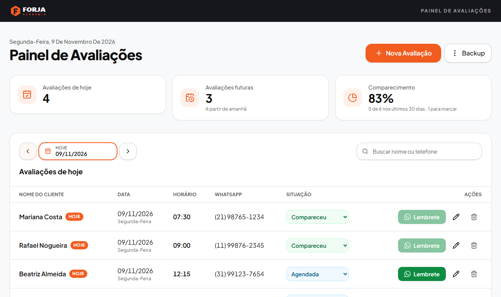

# Guia do usuário: Painel de Avaliações

Este guia é para quem usa o painel no dia a dia: a recepção e os professores da academia.
Ele explica como agendar avaliações físicas, mandar lembretes pelo WhatsApp e marcar quem veio.

> Procura como instalar o projeto, rodar o código ou criar uma nova marca? Veja o
> [README técnico](README.md).

## Sumário

1. [Instalar o programa](#1-instalar-o-programa)
2. [Conhecendo a tela](#2-conhecendo-a-tela)
3. [Agendar uma avaliação](#3-agendar-uma-avaliação)
4. [Ver outros dias](#4-ver-outros-dias)
5. [Procurar um aluno](#5-procurar-um-aluno)
6. [Mandar lembrete pelo WhatsApp](#6-mandar-lembrete-pelo-whatsapp)
7. [O aluno veio, faltou ou remarcou?](#7-o-aluno-veio-faltou-ou-remarcou)
8. [Corrigir ou excluir uma avaliação](#8-corrigir-ou-excluir-uma-avaliação)
9. [Backup: não perca seus dados](#9-backup-não-perca-seus-dados)
10. [Dúvidas comuns](#10-dúvidas-comuns)

## 1. Instalar o programa

Você recebe o programa num pendrive ou numa pasta, com duas opções:

- **Instalador (recomendado):** abra a pasta `Instalador` e dê dois cliques no arquivo
  `...-setup.exe`. Depois, siga as telas: **Avançar**, **Instalar** e **Concluir**. Não precisa ser
  administrador. O programa ganha um atalho na Área de Trabalho e no Menu Iniciar.
- **Versão portátil:** copie a pasta `...-Portatil` inteira para o computador (por exemplo, para
  Documentos) e dê dois cliques no `.exe` que está dentro dela.

Se aparecer a tela azul **"O Windows protegeu o computador"**, clique em **Mais informações** e
depois em **Executar assim mesmo**. O aviso aparece porque o programa não tem uma assinatura
digital paga, e isso é normal em programas feitos sob medida. Faça isso só com o arquivo que você
recebeu direto de quem fez o programa.

## 2. Conhecendo a tela

O painel abre sempre no **dia de hoje**.

- **No topo**, ficam três quadros:
  - **Avaliações de hoje:** quantas estão marcadas para hoje (as canceladas não contam).
  - **Avaliações futuras:** quantas estão agendadas de amanhã em diante.
  - **Comparecimento:** a porcentagem de alunos que vieram nos últimos 30 dias, e quantas
    avaliações ainda falta marcar.
- **Botão Nova Avaliação:** agenda um aluno.
- **Botão Backup:** guarda e recupera os dados.
- **Na tabela**, aparecem as avaliações do dia escolhido, em ordem de horário, com nome, data,
  horário, WhatsApp, situação e os botões de ação.

As etiquetas **Hoje** e **Amanhã** aparecem ao lado do nome. As avaliações que já passaram ficam em
cinza.

## 3. Agendar uma avaliação

1. Clique em **Nova Avaliação**.
2. Preencha os quatro campos, todos obrigatórios:
   - **Nome do cliente**: por exemplo, *Maria da Silva*.
   - **Data da avaliação.**
   - **Horário.**
   - **WhatsApp com DDD**: pode digitar com ou sem traços e parênteses, por exemplo,
     *(11) 98765-4321*.
3. Clique em **Salvar avaliação**.

Se algum campo estiver errado, a mensagem aparece logo abaixo dele, explicando o que corrigir.
Depois de salvar, o painel mostra o dia da avaliação.

Dá para cadastrar uma data que já passou, para registrar uma avaliação já feita.

## 4. Ver outros dias

O painel mostra **um dia por vez**. Para trocar de dia:

- use as **setas** ao lado da data para ir ao dia anterior ou ao próximo;
- clique na **data** para abrir o calendário e escolher qualquer dia;
- clique em **Ir para hoje** para voltar ao dia atual.

Se o painel ficar aberto de um dia para o outro, ele passa para o novo dia sozinho.

## 5. Procurar um aluno

Digite no campo **Buscar nome ou telefone**. A busca procura em **todas as datas**, e os resultados
aparecem agrupados por dia.

- Não importa maiúscula, minúscula ou acento: *alvaro* encontra *Álvaro*.
- Também dá para buscar por um pedaço do telefone, com 2 números ou mais.
- Para voltar ao painel normal, clique no **X** do campo de busca.

## 6. Mandar lembrete pelo WhatsApp

1. Na linha do aluno, clique em **Lembrete**.
2. O WhatsApp (ou o WhatsApp Web) abre com a mensagem pronta, com o nome, a data e o horário do
   aluno.
3. Confira a mensagem e clique em **enviar** no WhatsApp.

O programa **não envia sozinho**: quem envia é você. O computador precisa de internet e do WhatsApp
conectado.

O botão **Lembrete** só funciona para avaliações **agendadas** de hoje ou de dias futuros. Nas
avaliações que já passaram, foram canceladas ou já foram marcadas, ele fica apagado.

## 7. O aluno veio, faltou ou remarcou?

Na coluna **Situação**, escolha uma opção na lista da linha do aluno. A cor muda conforme a escolha:

| Opção | Quando usar |
| --- | --- |
| **Agendada** (azul) | é a situação de toda avaliação nova. Escolha de novo para desfazer uma marcação errada |
| **Compareceu** (verde) | o aluno fez a avaliação |
| **Faltou** (vermelho) | o aluno não veio |
| **Cancelada** (cinza) | a avaliação não vai acontecer. O nome aparece riscado |
| **Remarcar…** | abre uma janela para escolher a nova data e o novo horário |

Algumas regras:

- **Compareceu** e **Faltou** só podem ser marcados no dia da avaliação ou depois.
- Uma avaliação que já passou e ainda não foi marcada aparece em **amarelo**, como **Marcar
  presença**. O programa não marca falta sozinho: quem decide é você.
- Ao remarcar, a linha mostra de quando a avaliação veio, por exemplo
  *Remarcada · era 27/10 às 10:00*. Não dá para remarcar uma avaliação que o aluno já fez.

## 8. Corrigir ou excluir uma avaliação

- **Corrigir:** clique no **lápis** da linha, ajuste o que precisar e clique em **Salvar avaliação**.
  Use o lápis para corrigir erros de digitação. Para mudar o dia porque o aluno pediu, use
  **Remarcar…**, assim fica registrado.
- **Excluir:** clique na **lixeira** da linha e confirme em **Sim, excluir**. Isso não tem volta.

## 9. Backup: não perca seus dados

As avaliações ficam salvas **neste computador**. Se o computador estragar, os dados vão junto.
Por isso, **faça backup toda semana**.

### Fazer backup

1. Clique em **Backup** e depois em **Fazer backup (baixar arquivo)**.
2. O arquivo vai para a pasta **Downloads**, com a data e a hora no nome.
3. Copie esse arquivo para um pendrive ou para a nuvem (Google Drive, OneDrive).

### Restaurar um backup

Use quando trocar de computador ou se os dados se perderem.

1. Clique em **Backup** e depois em **Restaurar backup**.
2. Escolha o arquivo de backup.
3. O programa confere o arquivo e mostra quantas avaliações ele tem. Confirme em **Restaurar e
   substituir**.

**Atenção:** as avaliações atuais são **substituídas** pelas do backup. Antes disso, o programa
guarda sozinho uma cópia do que existia, para você poder voltar atrás. Se o arquivo não for um
backup válido, nada é alterado.

### Onde ficam os dados?

Clique em **Backup** e depois em **Onde ficam os dados?** para ver a pasta. Os dados continuam lá ao
fechar o programa, reiniciar o computador ou atualizar o programa.

Ao desinstalar, deixe **desmarcada** a opção *Remover dados do programa* (ela já vem desmarcada),
senão as avaliações são apagadas.

## 10. Dúvidas comuns

| Situação | O que fazer |
| --- | --- |
| Aparece "Não foi possível conectar ao servidor" | Feche o programa e abra de novo. Se continuar, reinicie o computador |
| O botão Lembrete está apagado | A avaliação já passou, foi cancelada ou já foi marcada. Só avaliações agendadas de hoje em diante têm lembrete |
| Não consigo marcar Compareceu ou Faltou | A avaliação é de um dia futuro. Espere o dia dela chegar |
| O WhatsApp abriu, mas a mensagem não foi | O programa só prepara a mensagem. Clique em enviar no WhatsApp |
| O número do WhatsApp foi recusado | Confira se tem DDD e se o celular começa com 9 depois do DDD |
| O painel apareceu vazio depois de reinstalar | Restaure o último backup (veja a [seção 9](#restaurar-um-backup)) |
| Vou trocar de computador | Faça um backup no computador antigo, instale o programa no novo e restaure o backup |
