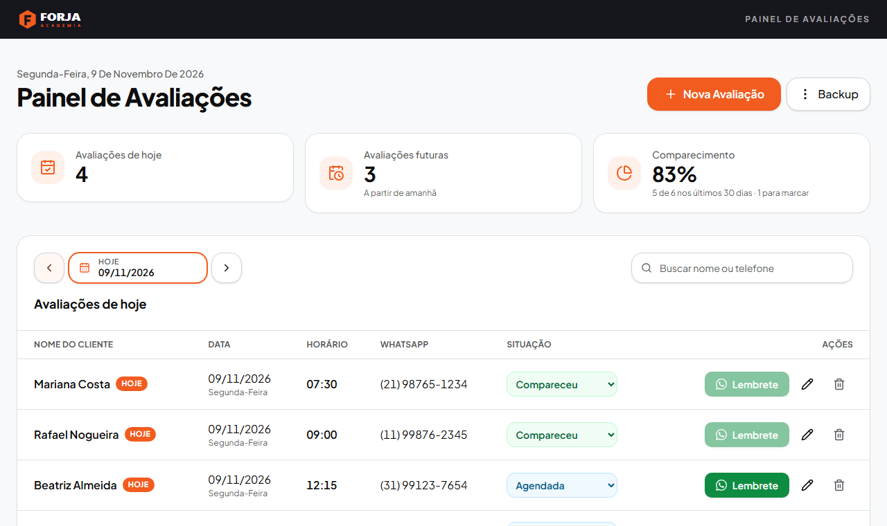

# Painel de Avaliações

Sistema para academias agendarem as avaliações físicas dos alunos, mandarem lembretes pelo
WhatsApp e acompanharem quem compareceu, faltou ou remarcou. Funciona de dois jeitos, com o mesmo código:

- **Navegador:** um servidor NestJS serve a API e a interface Angular. Abra `http://localhost:3000`.
- **Desktop (Windows):** um instalador `.exe` (Tauri) abre o painel numa janela própria e roda o
  mesmo servidor por baixo, sem o usuário perceber.

O projeto é white label: cada academia tem nome, logo, ícone, cores, textos do lembrete e
instalador próprios. A marca deste repositório, **Forja Academia**, é fictícia.



## Sumário

- [Arquitetura](#arquitetura)
- [Requisitos](#requisitos)
- [Instalação](#instalação)
- [Versão navegador](#versão-navegador)
- [Versão desktop](#versão-desktop)
- [Configuração](#configuração)
- [Regras de negócio](#regras-de-negócio)
- [API](#api)
- [White label: criar uma marca](#white-label-criar-uma-marca)
- [Segurança](#segurança)
- [Testes](#testes)
- [Estrutura de pastas](#estrutura-de-pastas)
- [Problemas comuns](#problemas-comuns)

## Arquitetura

```text
 Navegador                          Desktop (Windows)
 ─────────                          ─────────────────
 Chrome / Edge / Firefox            Janela Tauri (WebView2)
        │                                  │  inicia e encerra o servidor
        │ http://localhost:3000            │  http://127.0.0.1:<porta livre>
        ▼                                  ▼
 ┌─────────────────────────────────────────────────────┐
 │ NestJS (api/)                                       │
 │   /            interface Angular (dist/web)         │
 │   /api/...     avaliações, lembrete, backup, marca  │
 │        │                                            │
 │        ▼                                            │
 │ Regras de negócio (shared/)  ──►  SQLite (node:sqlite)
 └─────────────────────────────────────────────────────┘
```

| Camada | Tecnologia |
| --- | --- |
| Interface | Angular 22 (componentes standalone, signals, sem zone.js), Tailwind CSS 4, Angular CDK, Lucide |
| API | NestJS 11 (Express), Helmet |
| Banco | SQLite pelo módulo nativo `node:sqlite` (sem dependência nativa para compilar) |
| Regras de negócio | TypeScript puro em `shared/`, usado pela API e pela interface |
| Desktop | Tauri 2 (Rust). O instalador leva uma cópia do Node para rodar a API |
| Testes | Vitest (regras e banco), Playwright (interface, API e segurança) |

As regras ficam num lugar só. A interface usa as mesmas validações para mostrar os erros
na hora, e a API valida de novo antes de gravar.

## Requisitos

| Para | Precisa de |
| --- | --- |
| Rodar no navegador | [Node.js](https://nodejs.org) 22.13 ou mais recente |
| Gerar a versão desktop | Node.js, [Rust](https://rustup.rs) (toolchain MSVC) e Visual Studio C++ Build Tools |
| Usar o instalador pronto | Windows 10 ou 11. Nada mais |

## Instalação

```sh
git clone https://github.com/jorgeleitao/Gym-Fitness-Assessment-Scheduler.git painel-avaliacoes
cd painel-avaliacoes
npm install
```

## Versão navegador

### Desenvolvimento

```sh
npm run dev
```

Sobe a API em `http://127.0.0.1:3000` (recompila e reinicia a cada alteração) e o Angular em
`http://localhost:4200`, com recarga automática. O Angular repassa `/api` para a API
(`web/proxy.conf.json`). Abra **http://localhost:4200**.

Também dá para subir cada parte num terminal: `npm run dev:api` e `npm run dev:web`.

### Produção

```sh
npm run build    # gera dist/web (Angular) e dist/api/main.cjs (NestJS)
npm start        # http://localhost:3000
```

Em produção a própria API serve a interface; é um processo só. O banco fica em `dados/forja.db`
(a pasta é criada na primeira execução e não vai para o git).

## Versão desktop

```sh
npm run desktop:dev      # abre o app numa janela, sem gerar instalador
npm run desktop:build    # gera o instalador e a versão portátil
```

`desktop:build` leva alguns minutos e cria:

```text
distribuicao/forja/
  Instalador/
    Forja Painel_1.0.0_x64-setup.exe   instalador (não precisa de administrador)
    LEIA-ME.txt                        guia para a academia
  Forja-Painel-Portatil/
    Forja-Painel.exe                   versão sem instalar (leve a pasta inteira)
    LEIA-ME.txt
```

O que acontece por trás:

1. O Angular é compilado (`dist/web`).
2. A API é empacotada num arquivo só, já com as dependências (`dist/api-desktop/main.cjs`).
3. O `node.exe` da sua máquina é copiado para o app como `painel-node.exe`.
4. O Tauri compila a janela e monta o instalador NSIS com os ícones e o nome da marca.

Ao abrir, o app escolhe uma porta livre em `127.0.0.1`, inicia a API escondida (sem janela de
console), espera ela responder e abre a interface. Ao fechar a janela, a API é encerrada.

Na versão desktop:

- os dados ficam em `%APPDATA%\<identificador>\` (por exemplo `%APPDATA%\br.com.forja.painel\forja.db`);
- o botão **Lembrete** abre o WhatsApp no navegador padrão do Windows;
- o backup é salvo na pasta **Downloads**;
- a janela só navega dentro do servidor local, e só links `https://wa.me` saem para o navegador.

Outra marca: `npm run desktop:build -- <id-do-cliente>`. Guia completo, do zero até a entrega
ao cliente: [docs/NOVO-CLIENTE.md](docs/NOVO-CLIENTE.md).

## Configuração

A API lê variáveis de ambiente. Todas são opcionais.

| Variável | Padrão | Para que serve |
| --- | --- | --- |
| `PORTA` | `3000` | porta HTTP (`0` escolhe uma livre) |
| `HOST` | `127.0.0.1` | interface de rede. Só o próprio computador acessa |
| `HOSTS_PERMITIDOS` | (vazio) | nomes ou IPs extras aceitos no cabeçalho `Host`, separados por vírgula |
| `DADOS_DIR` | `./dados` | pasta do banco e das cópias de segurança |
| `CLIENTE` | `forja` | marca, pelo id da pasta em `clientes/` |
| `CLIENTE_DIR` | (vazio) | caminho direto da pasta da marca (usado pela versão desktop) |
| `WEB_DIR` | `./dist/web/browser` | build do Angular servido em `/` |

Para usar em mais de um computador da mesma rede (por exemplo, recepção e sala de avaliação):

```sh
HOST=0.0.0.0 HOSTS_PERMITIDOS=192.168.0.10 npm start
```

e acesse `http://192.168.0.10:3000` dos outros computadores. **Não há login:** quem acessa a
rede acessa o painel. Não exponha o servidor na internet.

## Regras de negócio

### Avaliação

Uma avaliação tem nome do aluno, data, horário e WhatsApp. Todos os campos são obrigatórios.

| Campo | Regra |
| --- | --- |
| Nome | 2 a 100 caracteres. Espaços repetidos viram um só e as pontas são cortadas |
| Data | data real no formato `AAAA-MM-DD` (`2026-02-31` é recusada). Datas passadas são aceitas, para registrar avaliações já feitas |
| Horário | `HH:mm`, de `00:00` a `23:59` |
| WhatsApp | DDD + 8 ou 9 dígitos |

O WhatsApp é aceito com ou sem máscara, com `+55` e com zero na frente (`+55 (21) 99999-9999`,
`021 3456-7890`, `21999999999`). Ele é gravado só com os dígitos, sem o `55`. São recusados:

- números sem DDD;
- DDD começando ou terminando em 0;
- celulares de 11 dígitos que não começam com 9 depois do DDD.

O DDD 55 (Rio Grande do Sul) não é confundido com o código do país.

Cada avaliação recebe um id (UUID) e as datas de criação e de última alteração (ISO 8601, UTC).
O banco repete as regras principais com `CHECK`, então um dado inválido não entra nem por fora
da API.

### Painel

- O painel abre sempre no dia de hoje do computador e mostra **um dia por vez**. Dá para trocar
  de dia pelas setas, pelo calendário ou pelo botão **Hoje**.
- "Hoje" acompanha o relógio: se o painel ficar aberto de um dia para o outro, ele vira sozinho.
- A lista é ordenada por data, horário e nome. Na ordem por nome os acentos são ignorados
  ("Álvaro" vem antes de "Beatriz").
- Etiquetas de data: **Hoje** e **Amanhã**. Avaliações que já passaram aparecem em cinza.
- Indicadores:
  - **Avaliações de hoje:** as de hoje, menos as canceladas;
  - **Avaliações futuras:** as agendadas de amanhã em diante;
  - **Comparecimento:** percentual de "compareceu" sobre "compareceu + faltou" nos últimos 30 dias,
    contando hoje, com o número de avaliações que ainda falta marcar.
- Uma nova avaliação começa na data selecionada no painel. Se essa data já passou, começa em hoje.
- Depois de salvar, o painel mostra o dia da avaliação salva.
- Cada situação de lista vazia tem uma mensagem própria (hoje, amanhã, dia futuro, ontem, dia passado).
- A exclusão pede confirmação.

### Situação: compareceu, faltou, remarcou

Cada avaliação tem uma situação, escolhida num select na coluna **Situação** da linha do aluno.
A cor do select acompanha a situação:

| Situação | Quando usar | Regra |
| --- | --- | --- |
| **Agendada** | padrão de toda avaliação nova | escolher de novo desfaz uma marcação feita por engano |
| **Compareceu** | o aluno fez a avaliação | só no dia da avaliação ou depois |
| **Faltou** | o aluno não veio | só no dia da avaliação ou depois |
| **Cancelada** | a avaliação não vai acontecer | qualquer data. Não conta em "Avaliações de hoje" e o nome aparece riscado |

- **Marcar presença:** uma avaliação que já passou e continua "Agendada" aparece em amarelo, com o
  select mostrando *Marcar presença*, e entra no contador "para marcar". Ela não é marcada como falta
  automaticamente: quem decide é a recepção.
- **Remarcar…** (última opção do select) abre uma janela para escolher a nova data e o novo
  horário, de hoje em diante. A avaliação volta a ser "Agendada", soma 1 em `remarcacoes` e guarda
  a data e o horário anteriores. A linha mostra
  *Remarcada · era 27/10 às 10:00* (ou *Remarcada 2x*). Não dá para remarcar uma avaliação que o
  aluno já fez, nem para a mesma data e horário.
- A mudança só aparece depois que o servidor confirma; se a regra recusar, o select volta para a
  situação gravada e um aviso explica o motivo.
- **Editar** continua servindo para corrigir digitação. Mudar a data por ali não conta como remarcação.
- **Lembrete** só para avaliações "Agendadas" de hoje ou futuras.

### Busca

- Procura em **todas as datas**, e os resultados são agrupados por dia.
- Procura pelo nome sem diferenciar maiúsculas nem acentos ("alvaro" encontra "Álvaro").
- Com 2 dígitos ou mais, também procura por parte do telefone.
- O texto é buscado literalmente: `%`, `_` e aspas não funcionam como curinga nem como SQL.
- A busca aceita até 100 caracteres.

### Lembrete pelo WhatsApp

- Só existe para avaliações **agendadas** de **hoje** ou **futuras**. Nas passadas, canceladas ou
  já marcadas, o botão **Lembrete** fica desabilitado.
- Há dois textos, um para avaliação de hoje e outro para avaliação futura (o futuro informa a
  data no formato `dd/mm/aaaa`). Cada marca pode definir os seus. Os textos padrão são:
  - hoje: *"Olá, {nome}! Tudo bem? Estou passando para lembrar da sua avaliação hoje, às {horário}. Contamos com sua presença! Até lá!"*
  - futura: *"Olá, {nome}! Tudo bem? Passando para lembrar que sua avaliação está agendada para o dia {data}, às {horário}. Contamos com sua presença! Até lá!"*
- A API relê a avaliação no banco na hora do clique, para usar o nome e o telefone atuais, e não
  os que estavam na tela.
- O link é `https://wa.me/55<DDD><número>?text=<mensagem codificada>`. O nome entra como texto:
  caracteres como `&`, `#`, `?` ou `$` não alteram o link nem o número.
- O app **não envia** a mensagem: ele abre o WhatsApp com o texto pronto e a pessoa clica em enviar.
- Os textos não podem ter emoji, porque o redirecionamento do `wa.me` troca emojis por "�".
  Acentos funcionam normalmente.

### Backup e restauração

- **Fazer backup** gera uma cópia consistente do banco (`VACUUM INTO`), mesmo com o painel em
  uso, e confere a cópia antes de entregar. O arquivo se chama `<prefixo>-AAAA-MM-DD_HH-MM-SS.db`.
- **Restaurar backup** passa por estas etapas, nesta ordem:
  1. Confere se o arquivo é SQLite, se está íntegro (`PRAGMA quick_check`), se tem uma *tabela*
     `avaliacoes` com todas as colunas e se **cada registro** é válido, inclusive a situação.
     Backups feitos antes da versão com situação também são aceitos: as avaliações voltam como
     "Agendada".
  2. Mostra quantas avaliações o backup tem e pede confirmação.
  3. Guarda uma cópia dos dados atuais em `copias-de-seguranca/antes-da-restauracao-<data>.db`.
  4. Troca as avaliações numa única transação: ou tudo é restaurado, ou nada muda.
- Um arquivo inválido é recusado com o motivo, e nenhum dado é alterado.
- O arquivo de backup pode ter no máximo 50 MB.
- **Onde ficam os dados?** mostra o caminho do banco.

## API

Todas as respostas são JSON. Erros sempre vêm como `{ "mensagem": "..." }`.

| Método | Rota | Descrição |
| --- | --- | --- |
| `GET` | `/api/avaliacoes?data=AAAA-MM-DD` | avaliações de um dia |
| `GET` | `/api/avaliacoes?busca=texto` | busca por nome ou telefone em todas as datas |
| `GET` | `/api/avaliacoes/contadores?hoje=AAAA-MM-DD` | `{ hoje, futuras, total, compareceram, faltaram, pendentes }` |
| `POST` | `/api/avaliacoes` | cria. Corpo: `{ nome, data, horario, whatsapp }`. Responde `201` com a avaliação |
| `PUT` | `/api/avaliacoes/:id` | altera. Mesmo corpo. Responde `204` |
| `DELETE` | `/api/avaliacoes/:id` | exclui. Responde `204` |
| `PATCH` | `/api/avaliacoes/:id/situacao` | corpo `{ situacao, hoje }`, com `agendada`, `compareceu`, `faltou` ou `cancelada`. Responde `204` |
| `POST` | `/api/avaliacoes/:id/remarcar` | corpo `{ data, horario, hoje }`. Responde a avaliação atualizada |
| `POST` | `/api/avaliacoes/:id/lembrete` | corpo `{ hoje }`. Responde `{ link }` |
| `GET` | `/api/backup` | baixa o backup (`.db`) |
| `POST` | `/api/backup/inspecionar` | corpo: o arquivo (`application/octet-stream`). Responde `{ total }` |
| `POST` | `/api/backup/restaurar` | corpo: o arquivo. Responde `{ total, copiaSeguranca }` |
| `GET` | `/api/backup/local` | caminho do banco |
| `GET` | `/api/cliente` | nome, nome curto, produto e versão da marca |
| `GET` | `/api/cliente/marca.css` · `/logo` · `/icone` | cores, logo e ícone da marca |

O `hoje` vem do navegador, para que "hoje" seja sempre a data de quem está usando o painel.

| Status | Quando |
| --- | --- |
| `400` | dado inválido (validação, data, id, corpo sem arquivo) |
| `403` | cabeçalho `Host` não permitido |
| `404` | avaliação não existe mais (ao editar, excluir ou mudar a situação) |
| `413` | corpo grande demais (20 KB para JSON, 50 MB para backup) |
| `422` | regra de negócio recusou: lembrete impossível, presença em data futura, remarcação inválida ou backup recusado |

Exemplo:

```sh
curl -X POST http://localhost:3000/api/avaliacoes \
  -H "Content-Type: application/json" \
  -d '{"nome":"Ana Lima","data":"2026-11-10","horario":"07:30","whatsapp":"(21) 99999-9999"}'
```

## White label: criar uma marca

Cada academia é uma pasta em `clientes/`:

```text
clientes/forja/
  cliente.json   nome, identificador, banco, cores e mensagens
  logo.svg       logo da barra do topo (svg, png, jpg ou webp)
  icone.svg      ícone do app e do instalador (svg ou png quadrado)
```

```json
{
  "nome": "Forja Academia",
  "nomeCurto": "Forja",
  "produto": "Forja Painel",
  "executavel": "Forja-Painel",
  "identificador": "br.com.forja.painel",
  "banco": "forja.db",
  "prefixoBackup": "forja-backup",
  "versao": "1.0.0",
  "logo": "logo.svg",
  "icone": "icone.svg",
  "cores": { "primaria": "#f25c1f", "barraTopo": "#16161d" }
}
```

| Campo | Para que serve |
| --- | --- |
| `nome` | nome da empresa (texto alternativo da logo, publicador do instalador) |
| `nomeCurto` | título da janela e da aba |
| `produto` | nome do programa, dos atalhos e da pasta de instalação |
| `executavel` | nome do `.exe` (sem espaços nem acentos) |
| `identificador` | identidade no Windows. Define a pasta de dados da versão desktop |
| `banco` | nome do arquivo SQLite |
| `prefixoBackup` | início do nome dos arquivos de backup |
| `versao` | versão do programa e do instalador |
| `cores.primaria`, `cores.barraTopo` | cor dos botões e destaques, e da faixa do topo |
| `cores.primariaSuave`, `primariaTexto`, `primariaContraste` | opcionais; derivados da primária quando omitidos |
| `mensagens.hoje`, `mensagens.futura` | opcionais; textos do lembrete com `{{nome}}`, `{{data}}` e `{{horario}}` |

```sh
cp -r clientes/forja clientes/minha-academia   # edite cliente.json, logo e ícone
npm run cliente:validar                        # aponta o campo e o motivo de cada erro
CLIENTE=minha-academia npm run dev             # navegador
npm run desktop:dev -- minha-academia          # desktop
```

Não mude `identificador` nem `banco` de uma academia que já usa o programa: o app passaria a
procurar os dados em outro lugar e o painel apareceria vazio.

## Segurança

A API não tem login. Ela foi feita para rodar no computador da academia (ou numa rede
interna), e a proteção está em não aceitar nada de fora:

- **Só escuta em `127.0.0.1`** por padrão.
- **Confere o cabeçalho `Host`**, o que bloqueia DNS rebinding (um site externo que aponta o
  próprio domínio para `127.0.0.1` para ler a API).
- **Não libera CORS:** outro site aberto no mesmo navegador não consegue ler nem alterar dados.
- **Content-Security-Policy restrita** (`default-src 'self'`, sem `unsafe-eval`, sem domínios
  externos, `frame-ancestors 'none'`), além dos demais cabeçalhos do Helmet.
- **SQL sempre parametrizado.** Na busca, `%` e `_` são escapados.
- **Validação duas vezes:** na interface, para avisar na hora, e na API, antes de gravar. A API só
  lê os quatro campos esperados, como texto; o id e as datas de criação são gerados por ela.
- **Restrições `CHECK` no banco**, como última barreira.
- **Limite de tamanho:** 20 KB para JSON e 50 MB para backup.
- **Erros sem detalhes internos:** sem stack trace e sem caminhos de arquivo do servidor.
- **Restauração defensiva:** recusa arquivos que não são SQLite, que estão corrompidos, que trocam
  a tabela por uma *view* ou que têm registros inválidos.
- **Desktop:** a janela não navega para fora do servidor local, só abre links `https://wa.me`
  e a página não tem acesso às APIs do Tauri.
- **Marca validada:** o `cliente.json` recusa cores que permitiriam injetar CSS e caminhos de
  arquivo fora da pasta da marca.

## Testes

```sh
npm test            # Vitest: regras de negócio, telefone, WhatsApp, banco, white label
npm run test:e2e    # Playwright: interface, API e segurança no navegador
npm run tipos       # checagem de tipos da API
```

Na primeira vez, instale o navegador do Playwright: `npx playwright install chromium`.

Os testes do Playwright geram o build de produção e, **para cada teste**, sobem a API real numa
porta livre com um banco SQLite novo numa pasta temporária. Os links do WhatsApp são
interceptados e registrados, sem acessar a internet.

| Arquivo | O que cobre |
| --- | --- |
| `tests-navegador/painel.spec.ts` | estado vazio, navegação entre dias, calendário, indicadores, cadastro, edição, exclusão, busca, lembrete, backup e restauração pela interface |
| `tests-navegador/situacao.spec.ts` | select de situação: compareceu, faltou, pendente, remarcar, cancelar e voltar para agendada, comparecimento e as regras na API |
| `tests-navegador/seguranca.spec.ts` | XSS em nome e busca, SQL injection, parâmetros extras no link do WhatsApp, validação, CSP (script inline, `fetch` e scripts externos bloqueados) e chamadas só para a própria API |
| `tests-navegador/api.spec.ts` | `Host` externo, CORS, cabeçalhos, arquivos fora do build, tipos errados, campos extras, corpo grande, erros sem detalhes internos, backups adulterados e backups da versão antiga |
| `tests/*.test.ts` | regras em `shared/` contra um SQLite real, com a mesma migration da API |

Relatório HTML: `npx playwright show-report`.

## Estrutura de pastas

```text
api/
  migrations/        SQL versionado (PRAGMA user_version)
  src/
    avaliacoes/      controller e service
    backup/          backup e restauração
    banco/           conexão SQLite e migrations
    cliente/         marca (dados, CSS, logo, ícone)
    config.ts        variáveis de ambiente
    seguranca.ts     Host, Helmet e filtro de erros
    main.ts
web/
  src/app/
    avaliacoes/      painel, tabela, formulário, remarcar, calendário, backup
    componentes/     diálogo, confirmação, barra do topo
    nucleo/          cliente HTTP, estado (signals) e avisos
  proxy.conf.json    /api → localhost:3000 no ng serve
shared/avaliacoes/   regras de negócio: validação, situação, telefone, datas, WhatsApp, repositório, serviço
clientes/            uma pasta por marca
src-tauri/           janela desktop (Rust): sobe a API e abre a interface
scripts/
  api.mjs            build da API com esbuild
  cliente.mjs        validação de marcas e build desktop
  cliente-config.mjs carregamento e validação do cliente.json
docs/                guia de nova marca e LEIA-ME entregue com o instalador
tests/               Vitest
tests-navegador/     Playwright
```

A interface não escreve SQL e a API não tem regra de negócio própria:
`componente → store → HTTP → controller → service → shared/ (regras + repositório) → SQLite`.

## Problemas comuns

| Problema | Solução |
| --- | --- |
| `node:sqlite` não encontrado | atualize o Node.js para 22.13 ou mais recente |
| Porta 3000 ocupada | `PORTA=3100 npm start` (no desenvolvimento, ajuste também `web/proxy.conf.json`) |
| Tela "Não foi possível conectar ao servidor" | a API não está rodando: use `npm run dev` ou `npm start` |
| `403 Host não permitido` ao acessar pela rede | inclua o IP ou nome em `HOSTS_PERMITIDOS` |
| `desktop:build` falha no Rust ou no linker | instale o Rust (MSVC) e o Visual Studio C++ Build Tools |
| Windows avisa "O Windows protegeu o computador" | o instalador não tem assinatura digital paga: "Mais informações" e depois "Executar assim mesmo" |
